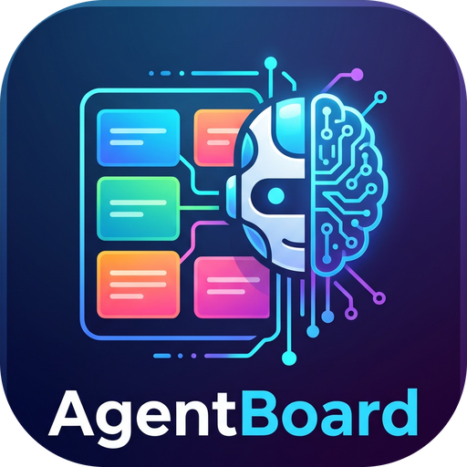
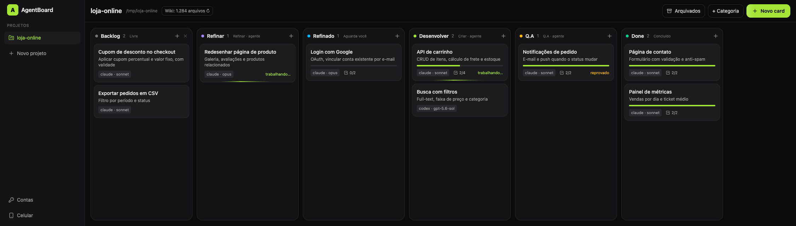
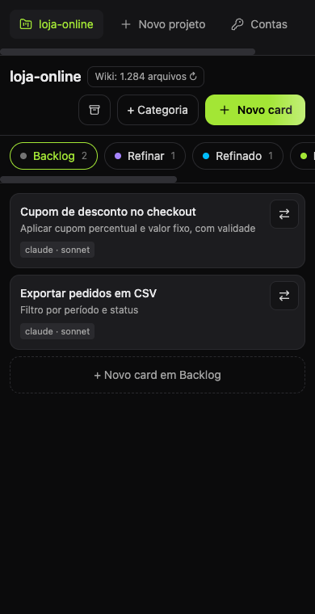
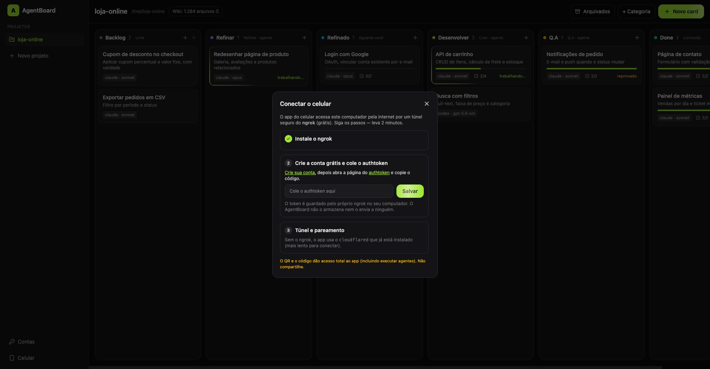
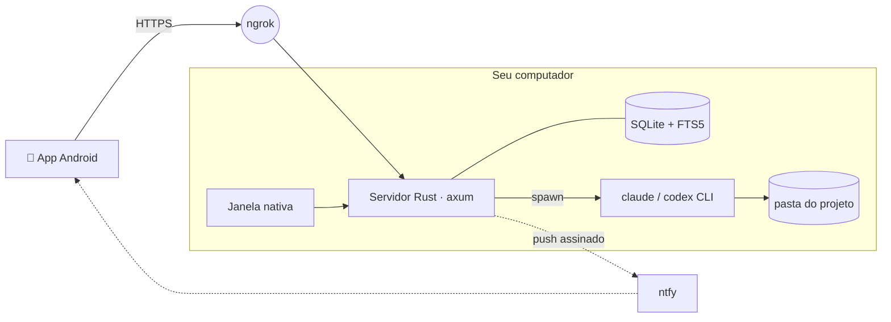

<div align="center">



# AgentBoard

**Um kanban que coloca agentes de IA para trabalhar nos seus projetos.**
Refine a ideia, deixe o agente desenvolver, valide com Q.A — do Mac, Windows, Linux ou do celular.




</div>

---

## ✨ O que faz

- **Colunas com agentes de verdade.** Mover um card para uma coluna dispara o agente daquela etapa:
  | Coluna | O que o agente faz |
  |---|---|
  | 🟣 **Refinar** | Conversa com você, faz perguntas e gera **contexto + checklist** do que precisa ser feito. Ao concluir, o card vai para *Refinado* e espera você. |
  | 🟢 **Desenvolver** | Implementa no diretório do projeto, **marca o checklist** conforme avança e, ao terminar, envia para o Q.A. |
  | 🟠 **Q.A** | Roda build e testes, cria os que faltam e valida as regras de negócio. Aprovou → **Done**. Reprovou → fica marcado para você. |
  | ⚪ **Livres** | Crie quantas categorias quiser; mova cards para qualquer lugar, a qualquer momento. |
- **Claude e Codex.** Usa as CLIs que já estão instaladas e logadas na sua máquina — escolha agente e **modelo por card**.
- **Wiki do projeto (RAG).** Ao criar o projeto, o app varre todas as pastas e monta uma "Wikipedia" local (README, manifests, módulos, símbolos e rotas do código). Todo agente recebe esse contexto, e o refinamento consulta o código antes de perguntar.
- **Chat em cada card**, parecido com o do Claude, com histórico e botão de parar.
- **Anexos**: texto, imagens, **áudio (transcrito para texto)** e links com acesso à web.
- **Celular de verdade.** App Android que espelha o board em tempo real, com push de cada ação. Funciona **fora da sua rede**.
- **Nativo e leve.** Servidor e janela em Rust (sem Electron), dados em SQLite no seu computador.

<div align="center">

</div>

## 📦 Downloads

Todo commit na `main` gera uma release nova com os instaladores:

| Plataforma | Arquivo |
|---|---|
| 🍎 macOS (Intel e Apple Silicon) | [`AgentBoard-macos.dmg`](../../releases/latest/download/AgentBoard-macos.dmg) |
| 🪟 Windows | [`AgentBoard-windows-setup.exe`](../../releases/latest/download/AgentBoard-windows-setup.exe) · [portátil `.zip`](../../releases/latest/download/AgentBoard-windows-x64.zip) |
| 🐧 Linux | [`AgentBoard-linux-amd64.deb`](../../releases/latest/download/AgentBoard-linux-amd64.deb) · [`.tar.gz`](../../releases/latest/download/AgentBoard-linux-x86_64.tar.gz) |
| 🤖 Android | [`AgentBoard.apk`](../../releases/latest/download/AgentBoard.apk) |

> Os instaladores não são assinados. No macOS, abra com **botão direito → Abrir** (ou `xattr -dr com.apple.quarantine /Applications/AgentBoard.app`). No Windows, **Mais informações → Executar assim mesmo**.
> Windows e Linux são compilados pelo CI, mas ainda têm pouco teste — issues são bem-vindas.

## 🚀 Primeiros passos

1. **Instale e abra** o AgentBoard. Na primeira execução um assistente guia a conexão do celular.
2. Em **Contas**, confira o login do **Claude** e do **Codex** (botão *Entrar* abre o navegador). Instale as CLIs antes:
   [Claude Code](https://docs.claude.com/en/docs/claude-code) · [Codex CLI](https://github.com/openai/codex).
3. **Novo projeto** → escolha a pasta (com navegador de pastas). A wiki é montada em segundos.
4. Crie um card no *Backlog* e arraste para **Refinar**. Converse com o agente, depois mova para **Desenvolver**.

## 📱 Conectando o celular (ngrok)

O celular acessa o seu computador por um túnel seguro. O assistente do app (**Celular** na barra lateral) faz tudo passo a passo:

1. **Instale o [ngrok](https://ngrok.com/download)** (grátis):
   `brew install ngrok` (macOS) · `winget install ngrok.ngrok` (Windows) · `sudo snap install ngrok` (Linux)
2. **Crie a conta grátis** em [dashboard.ngrok.com/signup](https://dashboard.ngrok.com/signup), copie o [authtoken](https://dashboard.ngrok.com/get-started/your-authtoken) e cole no assistente. Ele chama `ngrok config add-authtoken` por você — o token fica só na configuração do ngrok.
3. **Instale o APK**, abra e toque em **Escanear QR**. Pronto: board, chat e push em qualquer rede.

<div align="center"></div>

Sem ngrok, o app usa o `cloudflared` se estiver instalado (sem conta, porém mais lento para conectar). O computador precisa estar ligado com o AgentBoard aberto.

## 🧠 Como funciona



- Cada card guarda mensagens, checklist, contexto e anexos. Os agentes são processos das CLIs, rodando **dentro da pasta do projeto**.
- O agente sinaliza progresso por marcadores (`<check id="N"/>`, `<done/>`, `<qa verdict="pass|fail">`, `<refined>{…}</refined>`) que o servidor converte em checklist marcado, mudanças de coluna e o contexto do refinamento.
- A wiki é análise estática (sem chamar LLM): documentos, manifests, listagem de diretórios e símbolos viram trechos indexados em SQLite FTS5.
- O celular recebe o endereço do túnel por um anúncio **assinado com HMAC do seu token**, então terceiros não conseguem redirecioná-lo.

## ⚙️ Configuração

| Variável | Padrão | Descrição |
|---|---|---|
| `AGENTBOARD_PORT` | `7777` | Porta do servidor local |
| `AGENTBOARD_TUNNEL` | auto | `off` desliga o acesso remoto · `cloudflared` força o Cloudflare |
| `AGENTBOARD_PUBLIC_URL` | — | Usa uma URL fixa (Tailscale Funnel, domínio ngrok…) em vez de abrir túnel |
| `NTFY_SERVER` | `https://ntfy.sh` | Servidor ntfy para push (pode ser self-hosted) |
| `WHISPER_MODEL` | `~/.agentboard/ggml-base.bin` | Modelo do `whisper-cli` para transcrever áudio (requer `ffmpeg`) |

Execute com `--headless` para subir só o servidor, sem janela.

## 🔒 Segurança e privacidade

- **Nenhuma credencial vive no repositório.** Token de acesso e tópico de push são gerados no primeiro uso e ficam em `~/.agentboard/`. O authtoken do ngrok é guardado pelo próprio ngrok.
- ⚠️ Os agentes **editam arquivos e rodam comandos** nos seus projetos, e com o túnel ligado o servidor é alcançável pela internet protegido pelo token. **Não compartilhe o QR/código de pareamento.** Veja o [SECURITY.md](SECURITY.md).
- Push usa o `ntfy.sh` público por padrão (tópico aleatório): títulos de cards passam por lá. Use `NTFY_SERVER` com um servidor próprio para evitar.

## 🛠️ Compilando do código

```bash
# Desktop (Rust ≥ 1.85 e Node 22 + pnpm)
cd web && pnpm install && pnpm build && cd ..
cargo run --release              # janela nativa
./scripts/install-mac.sh         # macOS: instala ~/Applications/AgentBoard.app

# Android (JDK 17 + Android SDK)
./scripts/build-apk.sh           # → dist/AgentBoard.apk
```

Linux precisa de `libwebkit2gtk-4.1-dev libgtk-3-dev libxdo-dev`. A UI (React + Tailwind + dnd-kit) fica em `web/` e é embutida no binário.

### Release assinada do APK (opcional)

Sem configuração o APK é assinado com a chave de debug local. Para assinar com sua chave nas releases do CI, crie os *secrets* do repositório:
`ANDROID_KEYSTORE_BASE64`, `ANDROID_KEYSTORE_PASSWORD`, `ANDROID_KEY_ALIAS`, `ANDROID_KEY_PASSWORD`.

## 🤝 Contribuindo

Issues e PRs são bem-vindos. O CI roda `cargo check`, o build da UI e uma varredura de segredos (gitleaks) em cada PR.

## 📄 Licença

[MIT](LICENSE)
